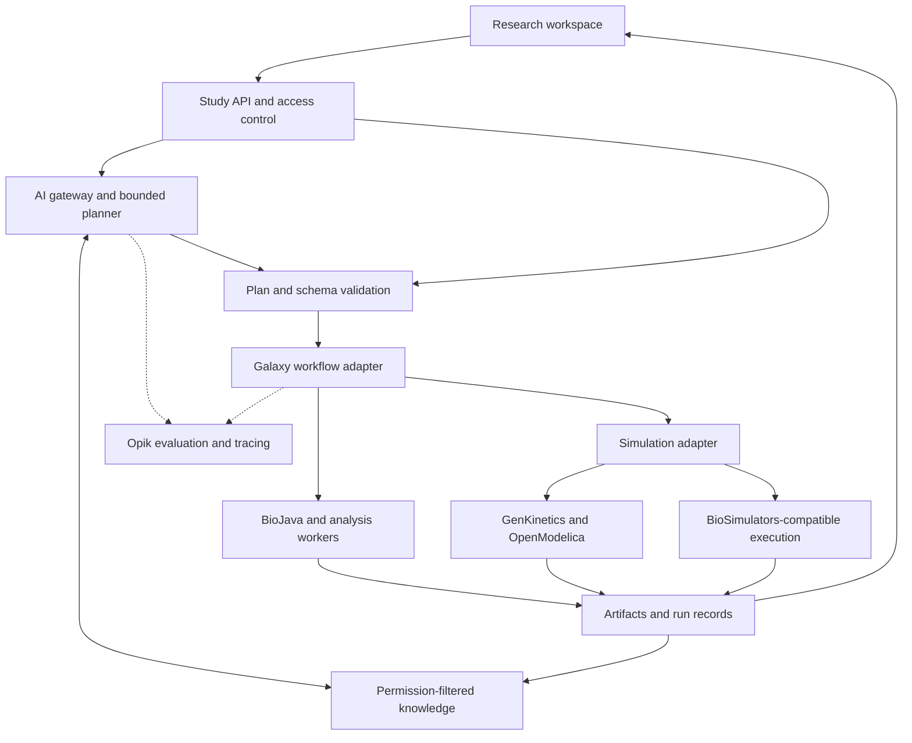
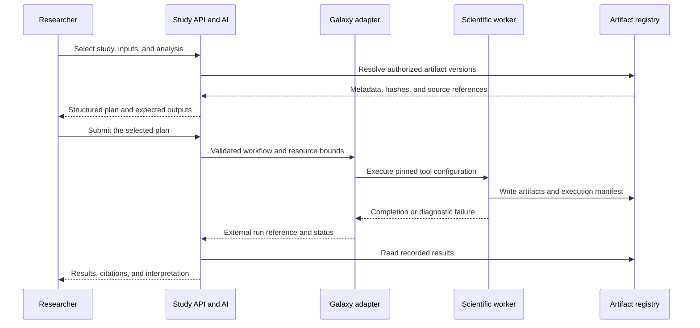

# JFXAI4BIO — AI-Powered Bioinformatics Simulation Platform

**An open, modular architecture for reproducible biological data analysis, scientific simulation, and AI-assisted research.**

Repository: [robotics-intelligent-systems/jfxai4bio](https://github.com/robotics-intelligent-systems/jfxai4bio)  
Organization: Robotics Intelligent Systems  
Document: Consolidated English architecture proposal  
Baseline reviewed: 13 September 2026  
Status: Proposed architecture and development roadmap

## Executive overview

JFXAI4BIO is proposed as a research workbench connecting biological data, computational models, analytical workflows, and evidence-based AI assistance. It consolidates the repository's software compendium into an architecture that research teams can implement progressively, operate on their own infrastructure, and extend through documented interfaces.

The recommended foundation combines Galaxy for scientific workflows, BioJava for biological data processing, Dash for the research interface, PostgreSQL for study records, and a local AI gateway for grounded explanations. GenKinetics and BioSimulations introduce complementary simulation paths. Opik records and evaluates AI interactions, while scientific benchmarks assess the numerical and biological results.

The platform should help a researcher answer three practical questions:

1. Which data, model, and workflow support this analysis?
2. Can another researcher reproduce the result with the recorded environment?
3. Which claims come from measured outputs, published evidence, or model-generated hypotheses?

The alternative proposed here uses self-hosted software, exportable scientific artifacts, replaceable model providers, and independently deployable workers. Hosted model APIs and commercial product editions remain optional integrations.

## Repository baseline

The reviewed repository tree contains a single `README.md`. It introduces **24 software references** and describes an intended MBSE/CAD/CAM/CAS organization. Application code, deployment manifests, tests, architecture images, MBSE directories, and a root license were not present in that snapshot.

This document retains all 24 references and assigns them a proposed role. Architecture diagrams, interfaces, directory paths, and delivery phases below are implementation targets. They do not represent an already deployed platform.

The source baseline can be checked in the [project README](https://github.com/robotics-intelligent-systems/jfxai4bio/blob/main/README.md) and [repository tree](https://github.com/robotics-intelligent-systems/jfxai4bio).

## Objectives and research use cases

| Use case | Proposed workflow | Reviewable output |
| --- | --- | --- |
| Biological data exploration | Register a dataset, validate its format, compute descriptive features, and inspect distributions | Quality report, feature table, data dictionary, and dataset version |
| Reproducible modeling studies | Execute a versioned simulation with declared initial conditions, solver settings, and parameter bounds | Time series, diagnostics, model archive, and run manifest |
| Protein representation analysis | Use an approved ESM checkpoint to compute representations of an existing research dataset | Embeddings, checkpoint identity, evaluation protocol, and limitations |
| Comparative machine learning | Compare a classical baseline with an optional domain model on a fixed split | Task metrics, uncertainty estimates where supported, and resource measurements |
| Research knowledge assistance | Retrieve approved documentation, model descriptions, and study outputs | A cited explanation with links to the underlying artifacts |
| Engineering and code assistance | Draft adapter code, workflow definitions, tests, and MBSE requirements from approved specifications | A reviewable change set and validation results |

The initial product is for computational research and education. Clinical decision-making, laboratory actuation, and experimental biological validation require separately defined capabilities and evidence.

## Architecture decisions

- **Keep workflow execution independent of the language model.** The AI assistant proposes structured plans; the workflow service validates and executes registered operations.
- **Use one owner for each execution state.** Galaxy owns its workflow and job states. JFXAI4BIO stores their identifiers and reconciles status through an adapter.
- **Exchange artifacts across runtimes.** Java, OCaml, Python, R, Scala, and Modelica components communicate through files, schemas, and service interfaces.
- **Separate scientific and linguistic evaluation.** A well-written answer cannot establish that a biological inference or numerical simulation is correct.
- **Start with a small deployment.** Add distributed analytics, specialized models, and graph services after the corresponding workloads justify them.
- **Record the complete computational context.** Data checksums, workflow versions, solver settings, model revisions, and execution environments travel with every result.

## Proposed system architecture



The two simulation branches are alternatives selected by model format and verified tool support. GenKinetics execution does not automatically become a BioSimulations-compatible study.

| Boundary | Responsibility | Proposed implementation |
| --- | --- | --- |
| Research interface | Dataset selection, workflow configuration, run progress, visualizations, and evidence review | Dash; optional JavaFX desktop client |
| Study API | Studies, permissions, artifact metadata, adapter registry, and run references | FastAPI with a PostgreSQL-backed application service |
| AI gateway | Model routing, context limits, structured responses, and evaluation hooks | Local Ollama initially; vLLM for a measured serving requirement |
| Knowledge service | Document ingestion, provenance, access filtering, and retrieval | PostgreSQL full-text retrieval; pgvector after choosing and evaluating a text embedding model |
| Workflow adapter | Submit, inspect, and cancel registered scientific workflows | Galaxy API through BioBlend |
| Scientific workers | Biological parsing, numerical analysis, model inference, and simulation | Isolated workers with independent dependency locks |
| Artifact service | Immutable inputs and outputs, checksums, manifests, and exports | Versioned filesystem volumes for the MVP; object storage adapter for scale |
| Evaluation | Scientific benchmark results and AI trace assessment | cz-benchmarks where task-compatible, numerical checks, and self-hosted Opik |

[BioBlend](https://github.com/galaxyproject/bioblend) provides a Python interface to Galaxy's API. [FastAPI](https://github.com/fastapi/fastapi), [pgvector](https://github.com/pgvector/pgvector), and the inference runtimes are proposed additions to the original compendium.

### Execution and provenance



Routine jobs execute under the researcher's assigned permissions. Policy checks cover data access, selected tools, resource limits, and external publication. An LLM response cannot grant additional permissions.

## Consolidated software compendium

**Core** identifies a component selected for early implementation. **Extension** identifies an optional capability. **Compatibility study** identifies a dependency that needs a focused build, license, or interoperability check.

The linked sources describe upstream capabilities; the integration roles and adoption choices are this project's proposal.

### Biological computing and simulation

| ID | Component and source | Role in JFXAI4BIO | Adoption |
| --- | --- | --- | --- |
| C01 | [Biocaml — OCaml Bioinformatics Library](https://github.com/biocaml/biocaml) | Optional typed biological parsing and transformations behind a command or file adapter | Extension; select supported formats and pin the OCaml environment |
| C02 | [OCaml Jupyter](https://github.com/akabe/ocaml-jupyter) | Notebook access to approved OCaml analysis environments | Extension; version the kernel with its dependencies |
| C03 | [GenKinetics](https://github.com/Mathemodica/GenKinetics) | Modelica representation of biochemical reaction networks | Simulation pilot; verify the compiler and library combination |
| C04 | [BioSimulations](https://github.com/biosimulations/biosimulations) | Reusable modeling studies and compatible simulation execution | Simulation extension; use the supported model and experiment formats |
| C05 | [BioJava](https://github.com/biojava/biojava) | Biological data parsing and feature extraction through a Java worker | Core; begin with one explicitly supported input format |
| C06 | [Jenetics](https://github.com/jenetics/jenetics) | Bounded numerical parameter fitting and multi-objective optimization | Extension; record objective functions, bounds, seeds, and convergence |

### Scientific workspaces and visualization

| ID | Component and source | Role in JFXAI4BIO | Adoption |
| --- | --- | --- | --- |
| C07 | [HyperSpyUI](https://github.com/hyperspy/hyperspyUI) | Specialized exploration of multidimensional signals and measurements | Extension; preserve axes, calibration, and units |
| C08 | [Dex Data Explorer](https://github.com/PatMartin/Dex) | JVM-based visual exploration and ETL for exported study tables | Compatibility study; validate its Java/Groovy/JavaFX environment |
| C09 | [Galaxy](https://github.com/galaxyproject/galaxy) | Reproducible scientific workflows, tool execution, histories, and training | Core workflow engine |
| C10 | [Aliro](https://github.com/EpistasisLab/Aliro) | Guided supervised machine learning for researchers | Extension through its own service or artifact exports |
| C11 | [Apache Zeppelin](https://github.com/apache/zeppelin) | Collaborative SQL/Scala and analytical notebooks | Extension for teams using the distributed data profile |
| C12 | [Dash](https://github.com/plotly/dash) | Main application UI for studies, metrics, plots, and reports | Core; use open-source Dash components |
| C13 | [DataMelt](https://datamelt.org/) | Existing JVM scientific scripts, numerical exploration, and visualization | Compatibility study; inventory the selected distribution and bundled libraries |

### AI, biological models, and evaluation

| ID | Component and source | Role in JFXAI4BIO | Adoption |
| --- | --- | --- | --- |
| C14 | [Opik](https://github.com/comet-ml/opik) | AI tracing, prompt versions, evaluation datasets, and regression analysis | Core evaluation capability, deployed locally |
| C15 | [cz-benchmarks](https://github.com/chanzuckerberg/cz-benchmarks) | Biological model evaluation using applicable benchmark tasks | Extension; map each task to a suitable dataset and metric |
| C16 | [rBio / rbio-1](https://github.com/czi-ai/rbio) | Comparison with a biological reasoning model trained with virtual-cell verifiers | Optional research profile; preserve base-model license conditions |
| C17 | [ESM3](https://github.com/Biohub/esm/blob/main/_assets/ESM3_README.md) | Protein sequence, structure, and function representations and research inference | Optional model worker; select an exact checkpoint and validate its terms |
| C18 | [Datumbox](https://github.com/datumbox/datumbox-framework) | Java statistical and machine-learning baselines | Extension for existing JVM pipelines |
| C19 | [Neo4j Graph Data Science / OpenGDS](https://github.com/neo4j/graph-data-science) | Graph analytics over curated biological relationships and provenance | Optional OpenGDS profile; distinguish its source build from the full distribution |

### Distributed data and polyglot runtimes

| ID | Component and source | Role in JFXAI4BIO | Adoption |
| --- | --- | --- | --- |
| C20 | [Apache Doris](https://github.com/apache/doris) | Analytical serving over aggregated study and benchmark tables | Scale extension; PostgreSQL remains the study system of record |
| C21 | [Apache DataFusion Comet](https://github.com/apache/datafusion-comet) | Acceleration of supported Spark SQL and DataFrame operations | Compatibility study with workload equivalence checks |
| C22 | [ADAM](https://github.com/bigdatagenomics/adam) | Distributed genomic analysis using Spark and structured genomic schemas | Scale extension for workloads requiring distributed processing |
| C23 | [Sparkling Water](https://github.com/h2oai/sparkling-water) | H2O machine learning within a compatible Spark environment | Scale extension with an independently verified dependency matrix |
| C24 | [FastR](https://github.com/oracle/fastr) | Optional R execution through GraalVM for existing polyglot applications | Compatibility study; retain standard R workers as the baseline alternative |

## Open-source baseline and alternatives

Use the core scientific application without a mandatory hosted-model subscription. Select model weights separately from server software and retain their exact source, revision, license, and applicable usage conditions.

| Capability | Recommended starting choice | Alternative or expansion criterion |
| --- | --- | --- |
| Scientific workflow execution | Self-hosted Galaxy | Add specialized executors through Galaxy or a documented adapter |
| Research UI | Dash open-source packages | JavaFX for a demonstrated desktop integration need; Zeppelin for notebooks |
| Study records and retrieval | PostgreSQL full-text search; add pgvector when needed | Separate vector infrastructure only after measuring scale or retrieval requirements |
| General language assistance | A local gateway; evaluate gpt-oss-20b as one candidate | Another suitable checkpoint with reviewed terms and benchmark evidence |
| Inference runtime | Ollama for a local pilot | vLLM for tested GPU serving and concurrency requirements |
| Tabular model baseline | scikit-learn | Datumbox for JVM workloads; Aliro or Sparkling Water when their capabilities are needed |
| Biological graph analysis | NetworkX and explicit provenance tables | OpenGDS for a validated Neo4j workflow |
| Numerical modeling | GenKinetics/OpenModelica compatibility pilot | An appropriate BioSimulators-compatible solver for an SBML study |
| LLM observability | Self-hosted Opik | Export traces and metrics through adapters rather than coupling scientific results to one UI |

The additional software candidates have primary sources at [Ollama](https://github.com/ollama/ollama), [vLLM](https://github.com/vllm-project/vllm), [scikit-learn](https://github.com/scikit-learn/scikit-learn), [NetworkX](https://github.com/networkx/networkx), and [OpenModelica](https://github.com/OpenModelica/OpenModelica). PostgreSQL uses its [PostgreSQL License](https://www.postgresql.org/about/licence/).

The [gpt-oss repository](https://github.com/openai/gpt-oss) documents Apache-2.0 licensing and a required Harmony response format. Its proposed role here is general language assistance and tool-plan generation. Biological expertise must be established by evaluation; a general language model is not a protein encoder or numerical solver. Memory planning must include the checkpoint, context cache, and concurrent requests.

### Licensing decisions that affect the architecture

| Component | Verified upstream distinction | Project decision |
| --- | --- | --- |
| rBio | The project releases its changes under MIT and identifies Qwen2.5-3B-Instruct as a base under the Qwen Research License | Keep rBio optional; the MIT notice does not replace the base-model conditions |
| ESM3 | The current Biohub ESM3 README points to an MIT license; older references and separately distributed artifacts can differ | Record the selected checkpoint's own terms and notices before enabling it; do not infer all service or dataset rights from the repository license |
| Neo4j GDS | The upstream README distinguishes the GPLv3 OpenGDS source build from a distribution containing additional closed components | Use the verified OpenGDS build when that optional graph profile is selected |
| cz-benchmarks | The package is MIT and its license explicitly identifies GPL dependencies, including igraph and leidenalg | Preserve the dependency notices and assess the actual delivered environment |
| GenKinetics | Its README identifies a Modelica 3-clause BSD license | Record the selected library release, compiler, and dependency licenses together |
| BioJava, Aliro, HyperSpyUI, and FastR | These include LGPL or GPL licensing rather than a single permissive license for the whole compendium | Preserve their obligations when distributing the corresponding workers |
| DataMelt | The project presents both an open-source application and Java library distributions | Inspect the actual package; avoid assigning one unverified license to every bundled component |

Sources: [rBio license](https://github.com/czi-ai/rbio/blob/main/LICENSE.txt), [ESM3 documentation](https://github.com/Biohub/esm/blob/main/_assets/ESM3_README.md), [ESM license](https://github.com/Biohub/esm/blob/main/LICENSE.md), [OpenGDS documentation](https://github.com/neo4j/graph-data-science/blob/2.13/README.adoc), [cz-benchmarks license](https://github.com/chanzuckerberg/cz-benchmarks/blob/main/LICENSE.md), and [GenKinetics README](https://github.com/Mathemodica/GenKinetics/blob/master/README.md).

Process isolation simplifies runtime dependencies. It does not remove license obligations.

## AI integration design

### Grounded research assistant

The assistant retrieves permission-filtered content from study descriptions, selected publications, tool manuals, model cards, workflow specifications, and completed run manifests.

Each retrieved item carries a source URL or artifact identifier, document version, section locator, access classification, and ingestion timestamp. An answer links claims to that evidence and states when the corpus does not support a conclusion.

Start with full-text retrieval and a small curated corpus. Add embeddings after defining a retrieval benchmark. Text embeddings and protein embeddings use separate indexes, model identifiers, and distance assumptions; their vectors are not interchangeable.

### Model gateway

Expose separate capabilities for:

- `text.generate`: explanations and structured workflow proposals.
- `text.embed`: document retrieval embeddings.
- `protein.embed`: representations of approved protein datasets.
- `model.evaluate`: benchmark execution.
- `simulation.execute`: a registered numerical model and solver.

Only the first three are model-inference capabilities. Evaluation and simulation are tool operations with their own schemas and runtime checks.

The gateway records model and tokenizer revisions, prompt-template versions, generation settings, latency, and structured output validation. It records concise decision summaries and cited evidence; internal reasoning traces are not a substitute for scientific provenance.

### Bounded agent workflow

A project-owned state machine is sufficient for the MVP. [LangGraph](https://github.com/langchain-ai/langgraph) is an optional implementation when checkpointing and branching become useful.

Proposed states:

`DRAFT → VALIDATED → QUEUED → RUNNING → SUCCEEDED | FAILED | CANCELLED`

Retries create an attempt within the same logical run. Exporting or publishing a result is a separate action from successful computation.

Tool access is limited to registered functions such as `search_sources`, `inspect_dataset`, `list_workflows`, `submit_workflow`, `get_run_status`, and `read_results`. The model supplies validated parameters to known tools; it does not supply executable shell commands.

### AI-assisted software development

For adapter and workflow development, an assistant can draft code against the repository's interface specifications, produce format fixtures, and explain failed builds. Run proposed changes in a disposable environment with pinned tools and synthetic fixtures. A maintainer reviews the change and its tests before it becomes a released workflow.

MCP may expose selected study and documentation tools to compatible clients. Each MCP call must use the same authorization, schema checks, and audit identifiers as the ordinary API. MCP does not provide permissions by itself.

## Scientific data and interoperability

| Artifact | Proposed representation | Required context |
| --- | --- | --- |
| Sequence collections | FASTA; FASTQ for a workflow that supports read-quality data | Alphabet, identifiers, source version, checksums, and read-quality encoding where applicable |
| Genomic records | ADAM-supported genomic formats and Parquet schemas | Reference assembly, coordinate convention, sample identifiers, and conversion version |
| Analysis tables | Parquet or CSV with a schema sidecar | Units, feature definitions, missing-value policy, and split identifiers |
| Multidimensional signals | A HyperSpy-compatible format selected for the instrument | Axis definitions, calibration, acquisition metadata, and provenance |
| Biochemical model | Modelica source for GenKinetics; SBML for an appropriate solver | Parameters, units, initial conditions, model revision, and supported model features |
| Simulation experiment | SED-ML and COMBINE/OMEX where supported | Experiment definition, model references, algorithm configuration, and expected outputs |
| Modelica exchange artifact | FMU where export and import have been verified | FMI version, interface type, target platform, variables, and runtime dependencies |
| AI result | JSON plus evidence references | Capability, checkpoint, template revision, evaluation status, and source links |
| Study package | Immutable manifest plus referenced artifacts | Input hashes, workflow revision, environment identity, outputs, and access policy |

BioSimulations distinguishes a model-sharing platform, runBioSimulations, and the BioSimulators registry of containerized tools. Its [documentation in the repository](https://github.com/biosimulations/biosimulations/blob/dev/README.md) describes their relationship to SBML, SED-ML, and COMBINE/OMEX.

SBML defines model syntax and semantics through its [specifications](https://sbml.org/documents/). FMI defines interfaces for model exchange and co-simulation; a model-exchange FMU needs an importer-side solver, while a co-simulation FMU commonly includes one. The adapter must inspect the actual FMU capabilities. See the [FMI specification](https://fmi-standard.org/docs/3.0.2/).

Do not assume lossless translation between Modelica and SBML. If conversion is introduced, validate supported semantics, units, events, and numerical behavior against reference fixtures.

## Proposed code and API contracts

The following code is an interface sketch for new implementation. It does not imply that a service, endpoint, or worker is already available.

```python
from dataclasses import dataclass
from typing import Mapping, Protocol

@dataclass(frozen=True)
class ArtifactRef:
    artifact_id: str
    sha256: str
    media_type: str

@dataclass(frozen=True)
class WorkflowPlan:
    study_id: str
    workflow_id: str
    workflow_revision: str
    inputs: tuple[ArtifactRef, ...]
    parameters: Mapping[str, object]
    max_runtime_seconds: int

@dataclass(frozen=True)
class RunRef:
    run_id: str
    backend: str
    external_run_id: str

class WorkflowAdapter(Protocol):
    def validate(self, plan: WorkflowPlan) -> tuple[str, ...]: ...
    def submit(self, plan: WorkflowPlan, idempotency_key: str) -> RunRef: ...
    def status(self, run: RunRef) -> str: ...
    def cancel(self, run: RunRef) -> None: ...
```

The Study API performs authorization before calling an adapter. Workers resolve artifact IDs through scoped access, verify input checksums, and use the registered runtime. The public API never accepts an unrestricted filesystem path or arbitrary executable name.

| Proposed endpoint | Purpose |
| --- | --- |
| `POST /v1/studies` | Create a study record with ownership and data classification |
| `POST /v1/artifacts` | Register an uploaded artifact and validate metadata |
| `POST /v1/plans` | Draft or submit a structured plan for validation |
| `POST /v1/runs` | Execute a validated, registered workflow using an idempotency key |
| `GET /v1/runs/{run_id}` | Return state, backend references, diagnostics, and output references |
| `POST /v1/runs/{run_id}/cancel` | Request cancellation and reconcile with the backend |
| `GET /v1/studies/{study_id}/report` | Produce an evidence-linked research report |

For deduplication, hash the study ID, workflow revision, input checksums, canonical parameters, and execution profile. Maintain a durable mapping between that key and the backend run ID. After a network timeout, reconcile backend status before resubmitting work.

### Run manifest example

This is an illustrative template. Placeholder values and null metrics must be populated by an actual run.

```yaml
schema_version: "1.0"
study_id: "demo-study"
run_id: "allocated-by-study-api"
workflow:
  id: "registered-feature-analysis"
  revision: "replace-with-immutable-workflow-revision"
  backend: "galaxy"
  external_run_id: null
inputs:
  - artifact_id: "registered-example-dataset"
    sha256: "replace-with-64-character-checksum"
environment:
  image_digest: "replace-with-pinned-container-digest"
  dependency_lock: "replace-with-lockfile-hash"
  hardware_profile: "record-at-execution"
execution:
  seed: 42
  max_runtime_seconds: 900
  state: "DRAFT"
simulation:
  model_revision: null
  solver: null
  tolerance_policy: null
ai:
  capability: "text.generate"
  checkpoint_revision: null
  prompt_template_revision: null
  evidence_ids: []
evaluation:
  benchmark_revision: null
  split_manifest: null
  metrics: null
outputs: []
```

A retrieval score or self-reported LLM confidence is not a calibrated probability of biological correctness. Only publish probabilistic estimates with their evaluation method and applicable scope.

## Runtime compatibility strategy

| Boundary | Integration rule |
| --- | --- |
| Java and OCaml libraries | Build independent workers with pinned JDK or OPAM environments and a small file/API contract |
| Python and R analytics | Maintain separate dependency locks; use standard R for initial R workflows |
| FastR and GraalVM | Verify each required R package and native extension before selecting the embedded runtime |
| ADAM, Sparkling Water, and Comet | Pin Spark, Scala, Java, native libraries, and extension versions as a tested combination |
| GenKinetics and OpenModelica | Build and run a reference model before committing to a compiler/library pairing |
| BioSimulations and Modelica | Use supported simulation formats or an explicitly developed adapter; no automatic compatibility assumption |
| CPU and GPU inference | Choose model size, precision, and concurrency from measured memory and latency requirements |

The [FastR README](https://github.com/oracle/fastr/blob/master/README.md) describes experimental compatibility and possible native-extension overhead. [GenKinetics](https://github.com/Mathemodica/GenKinetics) identifies OpenModelica frontend compatibility as development work.

[Comet](https://github.com/apache/datafusion-comet) targets Spark analytical execution. It does not establish that arbitrary ADAM operations or model inference will accelerate. Compare identical workloads and numerical outputs before enabling it.

Separate execution profiles can exchange Parquet artifacts when the selected ADAM and Comet releases do not share a compatible Spark/Scala stack.

## Deployment profiles

| Profile | Components | Intended use |
| --- | --- | --- |
| Local MVP | Dash, Study API, PostgreSQL, Galaxy, one BioJava worker, local artifacts; optional local LLM and Opik services | One team validating the workflow and evidence model |
| Simulation lab | MVP plus one verified GenKinetics/OpenModelica worker or compatible BioSimulators tool | Reproducible modeling studies and parameter analysis |
| Biological AI lab | Model registry, ESM or rBio workers, benchmark execution, and GPU scheduling | Controlled comparison of domain models |
| Distributed analytics | Compatible Spark/ADAM environments, optional Sparkling Water or Comet, and Doris analytical views | Datasets exceeding measured single-node capacity |

Use versioned OCI images and Compose-compatible deployment definitions for an initial lab. Adopt Kubernetes when multi-user isolation, scheduling, and operations justify its overhead. GPU workers, numerical solvers, and the UI have separate resource limits.

Public BioSimulations services and external model endpoints require an explicit outbound-data policy. Their credentials are optional; the baseline must support local execution and local result storage.

No fixed hardware bill or cost saving is claimed. Record dataset size, runtime, CPU/GPU memory, storage, and failure rate during the pilot, then size the deployment from those measurements.

## Evaluation and acceptance criteria

| Area | Proposed check | Evidence required before a release |
| --- | --- | --- |
| Data integrity | Validate schemas, identifiers, coordinate conventions, units, and input hashes | Passing fixtures and documented conversion behavior |
| Scientific simulation | Compare numerical outputs with a reference result using declared tolerances | Solver/version record, convergence diagnostics, and comparison report |
| Reproducibility | Re-run a manifest in the recorded environment | Matching artifacts where deterministic, or a justified tolerance/statistical comparison |
| Biological ML | Compare to a baseline on a fixed held-out split | Metrics with split provenance, dataset scope, and uncertainty where appropriate |
| RAG | Test retrieval relevance, citation support, and unsupported-question behavior | A versioned question/evidence set and evaluation report |
| Workflow reliability | Exercise cancellation, timeout reconciliation, retry, and duplicate submission | One logical run record with traceable attempts and backend states |
| Isolation | Verify cross-study access denial and worker resource boundaries | Access-control and execution tests |
| Performance | Measure representative end-to-end workloads | Latency, throughput, CPU/GPU memory, and cost observations |

For biological datasets, define the split unit before model selection: donor, study, batch, or sequence-homology group as appropriate to the task. Apply preprocessing within the training partition and retain the held-out data for evaluation. Related samples and homologous sequences require explicit leakage checks.

Choose metrics by task: macro-F1 or PR-AUC for a suitable classification task; RMSE/MAE for regression; numerical residuals and reference tolerances for simulation. Use [scikit-learn's evaluation guidance](https://scikit-learn.org/stable/model_selection.html) and relevant [cz-benchmarks tasks](https://github.com/chanzuckerberg/cz-benchmarks) to define the protocol.

Opik evaluates the assistant and its tool interactions. It complements scientific evaluation. Numerical reproducibility is not guaranteed by a random seed alone, especially across hardware, parallel execution, and solver changes.

Acceptance thresholds must be set against an agreed dataset and reference workflow before the pilot. No accuracy, speedup, or biological discovery rate has been measured for JFXAI4BIO.

## Data protection and operations

Use synthetic fixtures and appropriately licensed public data for the initial examples. Human genomic data can remain identifying after names are removed; apply controlled access and data-use restrictions when such datasets are introduced.

Keep source data and large sequence collections out of ordinary prompt logs. Store artifact references and redacted summaries in AI traces. Apply project access filters before retrieval, and manage retention and deletion across source artifacts, search indexes, and traces.

Scientific workers should run with resource quotas, scoped input access, and restricted network access. Retrieved documents, model responses, uploaded archives, and generated code are untrusted inputs. Validate them before processing or execution.

Track the study ID, logical run ID, backend job ID, and attempt ID across logs. Monitor queue age, failed and cancelled jobs, solver failures, memory pressure, invalid AI outputs, and missing evidence links.

## MBSE and proposed repository organization

Retain the original Arcadia/Capella intent and map it to concrete research requirements. CAD may describe physical measurement interfaces when relevant. CAM becomes relevant only if instrument or manufacturing work is added. CAS contains computational models, scenarios, reference results, and verification evidence.

All paths below are proposed additions to the current README-only repository.

| Proposed path | Responsibility |
| --- | --- |
| `MBSE/requirements/` | Requirements, assumptions, interfaces, and verification links |
| `MBSE/CAD/` | Optional physical or measurement-system design |
| `MBSE/CAM/` | Optional manufacturing and assembly studies |
| `MBSE/CAS/` | Simulation models, scenarios, and reference comparisons |
| `apps/research-workspace/` | Dash interface and reporting |
| `services/study-api/` | Study registry, authorization, artifact metadata, and run reconciliation |
| `services/ai-gateway/` | Retrieval, model routing, structured plans, and Opik integration |
| `adapters/galaxy/` | BioBlend integration and workflow state mapping |
| `workers/biojava/` | Biological parsing and feature extraction |
| `workers/simulation/` | Verified GenKinetics or BioSimulators execution profiles |
| `workers/domain-models/` | Optional ESM and rBio adapters |
| `contracts/` | Versioned API, artifact, plan, and run schemas |
| `workflows/` | Exported Galaxy workflows and tool wrappers |
| `evaluations/` | Scientific benchmarks, RAG cases, and split manifests |
| `deploy/` | Versioned local and cluster deployment definitions |
| `docs/decisions/` | Architecture decisions and runtime compatibility records |
| `licenses/` | Third-party notices, model terms, and dependency inventories |

Suggested traceability chain:

**Requirement → workflow or adapter → input fixture → validation result → release decision.**

Examples include preventing duplicate workflow submission, preserving simulation units, enforcing study access during retrieval, and reproducing a report from an immutable manifest.

## Implementation roadmap

The following is a planning estimate for a small team with bioinformatics, backend, and ML experience. Dates depend on dataset availability, compute access, and compatibility findings.

| Phase | Indicative effort | Deliverable | Exit condition |
| --- | --- | --- | --- |
| 0. Baseline and selection | 1 week | Component ledger, license decisions, research use case, and artifact contract | One agreed dataset, workflow, and measurable result |
| 1. First scientific workflow | 2 weeks | Study API, Galaxy adapter, BioJava worker, PostgreSQL records, and Dash results | Submit and reproduce a feature-analysis run |
| 2. AI assistance | 2 weeks | Local model gateway, cited retrieval, validated plan schema, and Opik traces | Evidence-linked explanations using a fixed evaluation set |
| 3. Simulation pilot | 2 weeks | One verified simulation worker and parameterized study | Reference output reproduced within declared tolerances |
| 4. Evaluation and packaging | 1–2 weeks | End-to-end evaluation, recovery tests, dependency inventory, and local deployment | A documented, repeatable research demonstration |
| 5. Optional expansion | Separate estimate | Protein models, OCaml/R notebooks, graph analytics, or distributed processing | Measured requirement and validated compatibility for each addition |

The MVP demonstration should register a synthetic or approved public dataset, execute a fixed analytical workflow, display its actual outputs, and generate a cited explanation. A second demonstration should reproduce a small modeling study with its solver settings and diagnostic report.

## Getting started

At the reviewed baseline, the repository can be cloned and its description inspected:

```bash
git clone https://github.com/robotics-intelligent-systems/jfxai4bio.git
cd jfxai4bio
```

A runnable JFXAI4BIO application is a roadmap deliverable. Before publishing startup commands, add dependency locks, tested container images, environment-variable documentation, health checks, and one complete sample workflow.

Develop each worker against its own upstream instructions. The first implementation guide should cover registration of the input data, Galaxy configuration, execution, result retrieval, and reproducibility checks.

## Contribution and governance

Contributions should identify the affected research workflow, source component, adapter contract, dependency versions, and validation evidence. Keep architecture proposals labeled until implementation exists.

Assign ownership for scientific methods, software integration, data stewardship, and release operations. The maintainers should define the contribution process and code of conduct as the implementation team forms; this document does not appoint specific people.

Use original upstream attribution. Inclusion in this compendium does not imply a partnership or endorsement by the component authors.

## Project licensing

No root license was present in the reviewed JFXAI4BIO baseline. A maintainer must select and add a license for original project code and documentation before claiming a licensed release. This proposal does not apply a license on the maintainers' behalf.

Maintain separate records for application code, third-party software, model weights, training/evaluation datasets, and generated study artifacts. Preserve notices and include a software bill of materials for each released deployment.

Scientific workers produce numerical results and diagnostics. The AI assistant connects those outputs to their evidence, and the study manifest records the information needed to inspect and reproduce the analysis.
